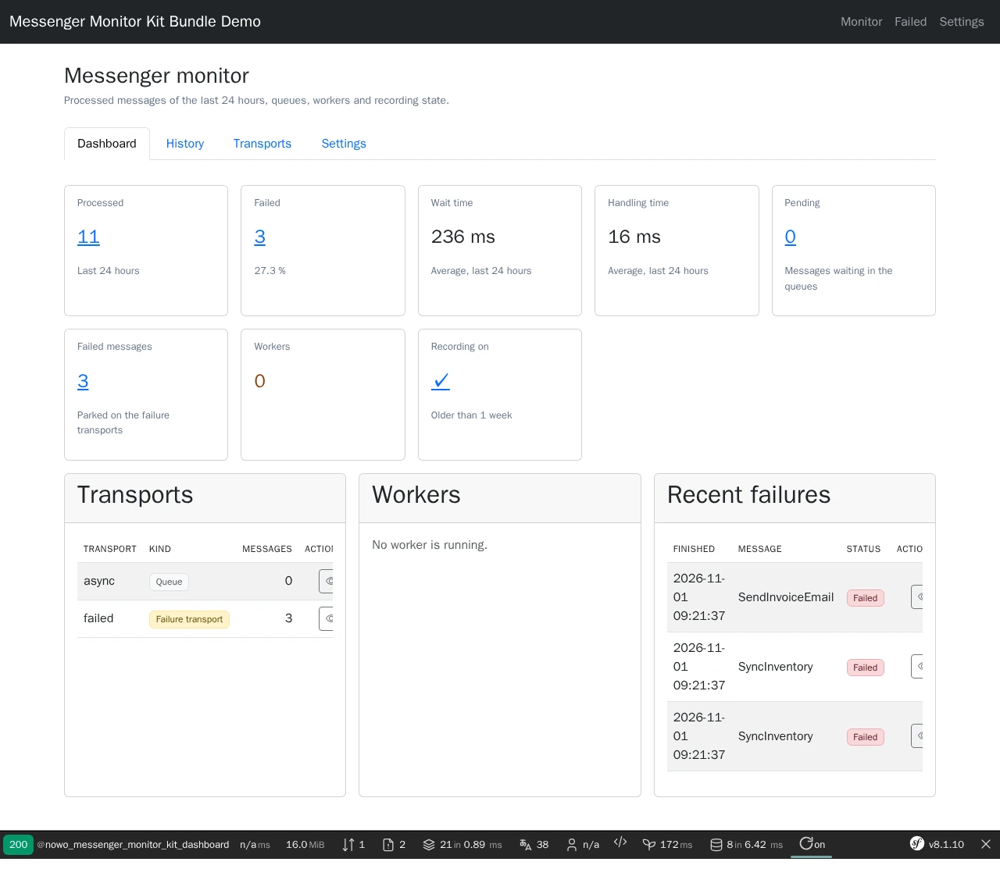
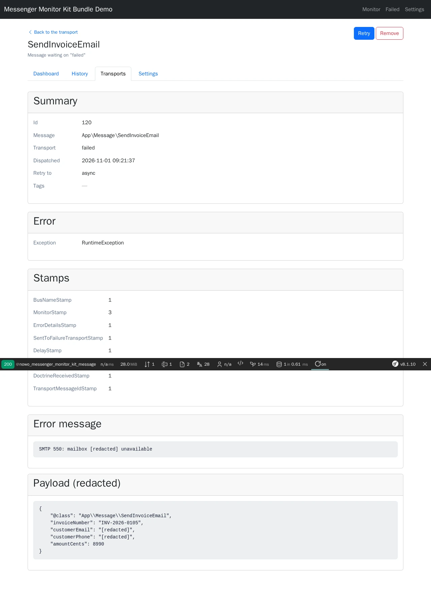

# Messenger Monitor Kit Bundle

[](https://github.com/nowo-tech/MessengerMonitorKitBundle/actions/workflows/ci.yml) [](https://packagist.org/packages/nowo-tech/messenger-monitor-kit-bundle) [](https://packagist.org/packages/nowo-tech/messenger-monitor-kit-bundle) [](LICENSE) [](https://php.net) [](https://symfony.com) [](https://github.com/nowo-tech/MessengerMonitorKitBundle) [](#tests-and-coverage)

> ⭐ **Found this useful?** [Install from Packagist](https://packagist.org/packages/nowo-tech/messenger-monitor-kit-bundle) · Give it a **star** on [GitHub](https://github.com/nowo-tech/MessengerMonitorKitBundle) so more developers can find it.

**Symfony Messenger monitoring on top of [zenstruck/messenger-monitor-bundle](https://github.com/zenstruck/messenger-monitor-bundle):** a UiKit admin UI (dashboard, filterable history, transports, failed messages), safe retry of failed messages back to their original transport, a runtime recording switch, batched retention, queue depth (with an optional HealthKit probe) and redaction of the personal data messages carry.

> 📋 **Compatible with Symfony 7.4, 8.0 and 8.1** · PHP 8.2+ (Symfony 8.x requires PHP 8.4+) · zenstruck/messenger-monitor-bundle ^0.6


This bundle is **FrankenPHP worker mode friendly**.

## Screenshots

<table>
  <tr>
    <td align="center" width="50%">
      
      <br /><sub>Dashboard — last 24 hours, queue depth, workers, recent failures</sub>
    </td>
    <td align="center" width="50%">
      
      <br /><sub>Failed message — redacted payload, retry to the original transport</sub>
    </td>
  </tr>
</table>

## Features

- **Builds on zenstruck** (no fork): decorates its history storage, reuses its transports, workers and history models.
- **UiKit admin UI** under `/admin/messenger`: dashboard, history with FormKit GET filters, pagination and sorting, history row with attempts, transports with depth, failed messages, message detail, settings — UiKit scaffolds, one host theme, 7 locales.
- **Safe retry**: back to the transport the message failed on (or a fallback), never inline; CSRF, manage role, confirm dialog, per-message lock (`symfony/lock`), batch limits, duplicate-risk warnings; remove one or all.
- **Runtime recording switch**: stop or resume history recording, or high-volume message classes, without a redeploy — stored in a shared cache pool, an [InstanceSettings](https://github.com/nowo-tech/InstanceSettingsBundle) section (optional) or the configuration.
- **Retention**: keyset-batched purge (no huge DELETE), manual from the UI or CLI, automatic with `nowo:messenger-monitor:purge --auto`.
- **Personal data (RGPD)**: payloads, handler results and failure messages redacted (key list, e-mails, long numbers, host redactors), payloads for managers only, results minimised before storage.
- **Queue depth** service and optional [HealthKit](https://github.com/nowo-tech/HealthKitBundle) readiness probe.
- **Messenger plumbing**: `NoRetryOnDecodingFailureRetryStrategy`, broker-neutral AMQP / Doctrine transport factories, `messenger_failed_dsn` env processor (all opt-in).
- **Private by default**: `ROLE_ADMIN`, separate manage roles, custom checker, fail-closed CSRF, opt-in routes, audit events.

## Installation

```bash
composer require nowo-tech/messenger-monitor-kit-bundle
```

```yaml
# config/routes/nowo_messenger_monitor_kit.yaml
nowo_messenger_monitor_kit:
    resource: .
    type: nowo_messenger_monitor_kit
```

```yaml
# config/packages/security.yaml
security:
    access_control:
        - { path: ^/admin/messenger, roles: ROLE_ADMIN }
```

Add that line to your own `access_control` list: the Flex recipe deliberately ships no security file (a second
`access_control` definition would replace yours, not merge with it).

Create the history table with a migration (`doctrine:migrations:diff`). Details: [docs/INSTALLATION.md](docs/INSTALLATION.md).

## Quick start

```yaml
# config/packages/nowo_messenger_monitor_kit.yaml
nowo_messenger_monitor_kit:
    recording:
        optional_message_classes: [App\Message\TrackPageView]
    retention:
        auto_purge: true
        older_than: 1-month
    retry:
        duplicate_risk_classes: [App\Message\SendInvoiceEmail]
    security:
        access_roles: [ROLE_ADMIN]
        manage_roles: [ROLE_SUPER_ADMIN]
```

```cron
*/15 * * * * php bin/console nowo:messenger-monitor:purge --auto
```

## Requirements

- PHP 8.2–8.5, Symfony 7.4 / 8.0 / 8.1, Doctrine ORM 3.3+
- `zenstruck/messenger-monitor-bundle` ^0.6, UiKitBundle ^2.20, FormKitBundle ^2.17 (dependencies)
- A listable failure transport (Doctrine or Redis) for the failed message pages

## Configuration

See [docs/CONFIGURATION.md](docs/CONFIGURATION.md) (every key, stores, redaction, security, timeouts).

## Usage

See [docs/USAGE.md](docs/USAGE.md) (pages, retry semantics, services, hooks, template overrides).

## Demo

- `demo/symfony8` — Symfony **8.1** (FrankenPHP PHP **8.5**, worker mode) with MySQL; host port **8094** by default. Doctrine transports `async` and `failed`; the seed runs a worker so the history and the failure transport are filled.

Runtime mode is **`FRANKENPHP_MODE`** (`worker` default, or `classic`) — see [docs/DEMO-FRANKENPHP.md](docs/DEMO-FRANKENPHP.md).

```bash
make -C demo up-symfony8          # http://localhost:8094
make -C demo/symfony8 setup       # schema, Messenger tables, demo messages
make test-e2e                     # Playwright e2e against the running demo
make demo-screenshots             # refresh docs/images/demo/*.webp
make demo-smoke                   # boot, HTTP 200, down (REQ-TEST-011)
```

## Development

```bash
make up
make install
make test
make cs-check
make phpstan
make igor
make test-coverage-100
make release-check
```

## Documentation

- [Installation](docs/INSTALLATION.md)
- [Configuration](docs/CONFIGURATION.md)
- [Usage](docs/USAGE.md)
- [Contributing](docs/CONTRIBUTING.md)
- [Code of Conduct](CODE_OF_CONDUCT.md)
- [Changelog](docs/CHANGELOG.md)
- [Upgrading](docs/UPGRADING.md)
- [Release](docs/RELEASE.md)
- [Security](docs/SECURITY.md)
- [Engram](docs/ENGRAM.md)
- [Spec-driven development](docs/SPEC-DRIVEN-DEVELOPMENT.md)
- [GitHub Spec Kit](docs/SPEC-KIT.md)

### Additional documentation

- [Templates (UiKit page contract)](docs/TEMPLATES.md)
- [Architecture](docs/ARCHITECTURE.md)
- [PSR evaluation (REQ-CS-007)](docs/PSR.md)
- [Demo (FrankenPHP)](docs/DEMO-FRANKENPHP.md)
- [FrankenPHP worker audit (kernel not reset)](docs/FRANKENPHP-WORKER-AUDIT.md)
- [GitHub Actions CI requirements](docs/GITHUB_CI.md)

## Tests and coverage

- Tests: PHPUnit (PHP) — unit tests plus kernel integration tests (admin UI end to end with SecurityBundle, CSRF, Doctrine Messenger transports and history on SQLite, retry / remove, settings, purge, opt-in routes, invalid configuration) and the UiKit page contract test; Playwright e2e on the demo
- PHP: 100% (1803/1803 statements, 2046/2046 elements; gate enforced in CI by `composer test-coverage-100`, no exclusions)
- TS/JS: N/A
- Python: N/A

## License and author

MIT · [Nowo.tech](https://nowo.tech) · [Héctor Franco Aceituno](https://github.com/HecFranco)
